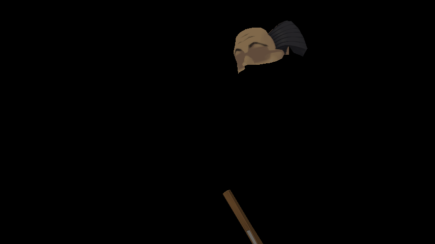
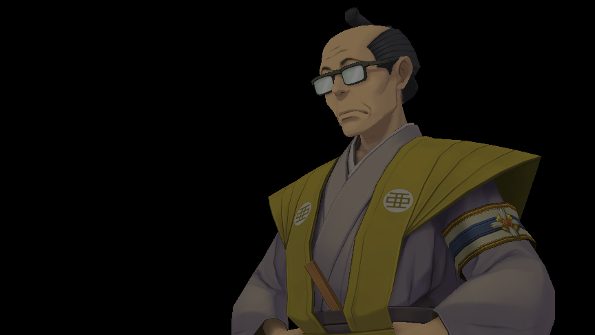

# Fix for invisible / "floating head" characters in The Great Ace Attorney Chronicles on older Intel graphics (Linux)

On older Intel integrated graphics, the 3D characters in *The Great Ace Attorney Chronicles* are mostly missing when you play on Linux through Steam Proton. You see floating heads, eyes, hair or props, and the rest of the body is gone or crushed flat.

**This is a bug in the Intel graphics driver (Mesa), not in the game or Proton.** That's why switching Proton versions, DXVK/WineD3D or graphics settings doesn't help. This repository contains a small driver patch and a step-by-step guide to build a fixed copy of the driver that only this game uses. Your system drivers are not touched.

| Before (stock driver) | After (patched driver) |
|---|---|
|  |  |

*Both pictures are the same frame from a recording of the game, replayed on the stock and the patched driver.*

📄 **The same guide as a PDF:** [TGAAC-Intel-Fix-Guide.pdf](TGAAC-Intel-Fix-Guide.pdf)

## Who this is for

| Your GPU | Status |
|---|---|
| Intel HD 5300 / 5500 / 5600 / 6000, Iris 6100 / 6200, Iris Pro P5700 / 6200 (5th gen Core, "Broadwell") | **This guide.** Tested on HD 5500. |
| Intel HD 400 / 405 ("Braswell", "Cherry Trail") | Same graphics generation (Gen8). Very likely affected; untested. |
| Intel HD 4200–5200 ("Haswell") and older | Uses the same driver code. Might be affected; untested. |
| Intel 6th gen ("Skylake") or newer, AMD, NVIDIA | Not this bug. |

To check your GPU, run:

```sh
lspci | grep -i vga
```

**Quick way to confirm you have this bug:** set the game's launch options to `LIBGL_ALWAYS_SOFTWARE=1 PROTON_USE_WINED3D=1 %command%`. This renders on the CPU, so it's very slow, but if the characters show up correctly, you have this bug. Remove the option again afterwards.

## Why it happens

Characters are animated with a skeleton. For every point of a character's body, the game reads that bone's position from a small table (a texture) stored on the GPU. It reads the second and third row of each bone as "this cell, then 1 / 2 cells to the right."

The game's coordinates land *exactly* on the border between two cells. On these Intel chips, the hardware's "N cells to the right" lookup (a texel offset in a vertex shader, with nearest filtering) grabs the **wrong neighbouring cell** in that exact situation. So parts of the body get another bone's position and are thrown away or flattened.

The patch changes Mesa's shader compiler for these chips (`src/intel/compiler/elk/elk_nir.c`). For non-fragment shaders, the driver adds the offset to the coordinate itself and moves the result 1/256 of a cell inside the correct cell, so the hardware can't pick the wrong one. Setting `ELK_KEEP_VTX_TEX_OFFSET=1` disables it.

## Guide

You need about 2–3 GB of disk space and 15–40 minutes, mostly spent waiting. Everything goes into `~/mesa-tgaac`.

### 1. Install the build tools

**Arch Linux / Manjaro / EndeavourOS (tested):**

```sh
sudo pacman -S --needed base-devel git meson ninja python-mako python-ply \
  python-packaging python-yaml llvm clang libclc spirv-llvm-translator \
  spirv-tools glslang libdrm wayland wayland-protocols libxrandr \
  libxshmfence vulkan-icd-loader
```

**Other distributions (untested):** install Mesa's build dependencies, for example `sudo apt build-dep mesa` (Debian/Ubuntu, needs source repositories enabled) or `sudo dnf builddep mesa` (Fedora), plus `git` and a recent `meson` (`pip install --user meson` if yours is too old).

### 2. Download Mesa and apply the patch

```sh
mkdir -p ~/mesa-tgaac && cd ~/mesa-tgaac
curl -LO https://raw.githubusercontent.com/courierrrrr/tgaac-intel-fix/main/elk-vtx-offset.patch
git clone https://gitlab.freedesktop.org/mesa/mesa.git src
cd src
git checkout 335d5698dca1d1b9d11ef18cf5f523cc0f7f58fb
git apply ../elk-vtx-offset.patch
```

The `git checkout` line selects the exact Mesa version the patch was tested on. If `git apply` prints nothing, the patch applied correctly.

### 3. Build the Vulkan driver

This only builds the Intel Vulkan driver for older chips ("hasvk"):

```sh
cd ~/mesa-tgaac/src
meson setup ../build -Dbuildtype=release -Dprefix=$HOME/mesa-tgaac/install \
  -Dvulkan-drivers=intel_hasvk -Dgallium-drivers= -Dplatforms=x11,wayland \
  -Dglx=disabled -Degl=disabled -Dgles1=disabled -Dgles2=disabled \
  -Dopengl=false -Dvideo-codecs= -Dintel-rt=disabled
ninja -C ../build install
```

This file must exist afterwards:

```sh
ls ~/mesa-tgaac/install/share/vulkan/icd.d/intel_hasvk_icd.x86_64.json
```

### 4. Put DXVK 2.5.1 in the game folder

DXVK 2.6 and later, including the version inside current Proton, refuses to run on these chips. 2.5.1 works:

```sh
cd ~/mesa-tgaac
curl -LO https://github.com/doitsujin/dxvk/releases/download/v2.5.1/dxvk-2.5.1.tar.gz
tar xf dxvk-2.5.1.tar.gz
cp dxvk-2.5.1/x64/d3d11.dll dxvk-2.5.1/x64/dxgi.dll \
   ~/.local/share/Steam/steamapps/common/TGAAC/
```

If your game is installed somewhere else, find the folder via Steam: right-click the game → **Manage** → **Browse local files**.

### 5. Set up Steam

1. Right-click the game → **Properties** → **Compatibility**, and force **GE-Proton** (tested with GE-Proton11-9; install it with ProtonUp-Qt).
2. Create the launcher script:

   ```sh
   cat > ~/mesa-tgaac/run <<'EOF'
   #!/bin/sh
   ICD=$HOME/mesa-tgaac/install/share/vulkan/icd.d/intel_hasvk_icd.x86_64.json
   export VK_DRIVER_FILES=$ICD VK_ICD_FILENAMES=$ICD
   export WINEDLLOVERRIDES="d3d11,dxgi=n,b"
   exec "$@"
   EOF
   chmod +x ~/mesa-tgaac/run
   ```

3. In **General** → **Launch Options**, enter this, replacing `YOURNAME` with the output of `whoami`:

   ```
   /home/YOURNAME/mesa-tgaac/run %command%
   ```

4. Start the game and go into a scene with characters.

## Troubleshooting

To see what the game actually uses, set the launch options to `PROTON_LOG=1 /home/YOURNAME/mesa-tgaac/run %command%`, start the game once, then run:

```sh
grep -E "DXVK: v|Driver *:" ~/steam-1158850.log
```

You should see `DXVK: v2.5.1` and a Mesa version of 26.99 or higher.

| Symptom | Fix |
|---|---|
| Game doesn't start / no Vulkan device | Check `YOURNAME` in the launch options, and that `~/mesa-tgaac/run` and the `.json` file from step 3 exist. |
| Log shows a different DXVK version | The DLLs aren't in the game folder. Copy them again (step 4). |
| Broken again after "Verify integrity of game files" or a game update | Steam removed the DXVK DLLs. Copy them again (step 4). |
| Still broken although the log looks right | Your GPU may have a different bug. Open an issue with your GPU model and log. |

## Undo

1. Clear the launch options.
2. Delete `d3d11.dll` and `dxgi.dll` from the game folder, then run **Verify integrity of game files**.
3. Delete `~/mesa-tgaac`.

## Files

- [`elk-vtx-offset.patch`](elk-vtx-offset.patch): the Mesa patch.
- [`TGAAC-Intel-Fix-Guide.pdf`](TGAAC-Intel-Fix-Guide.pdf): this guide as a PDF.
- `images/`: before/after frames.
